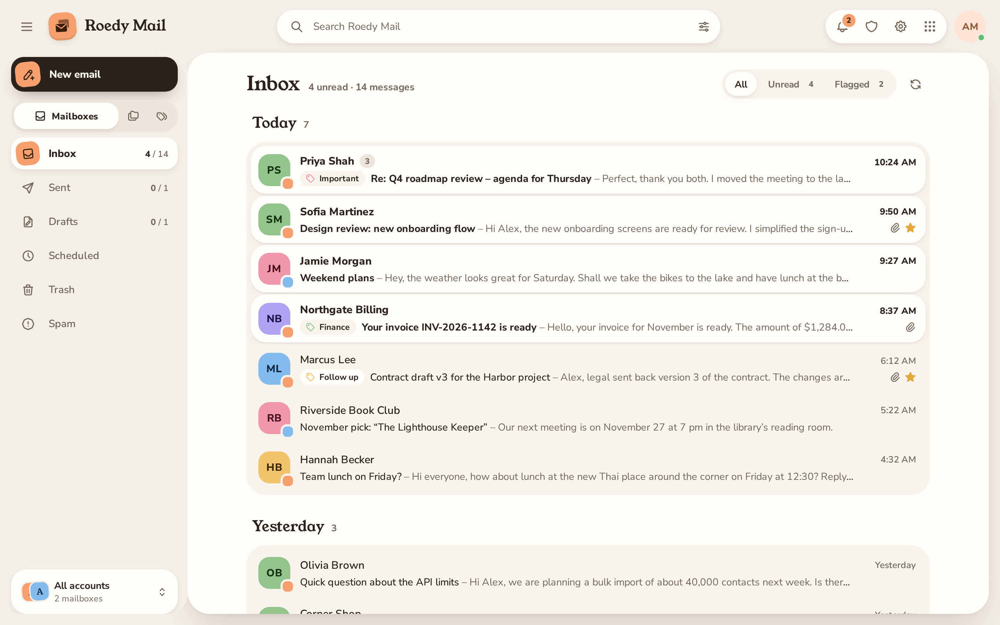
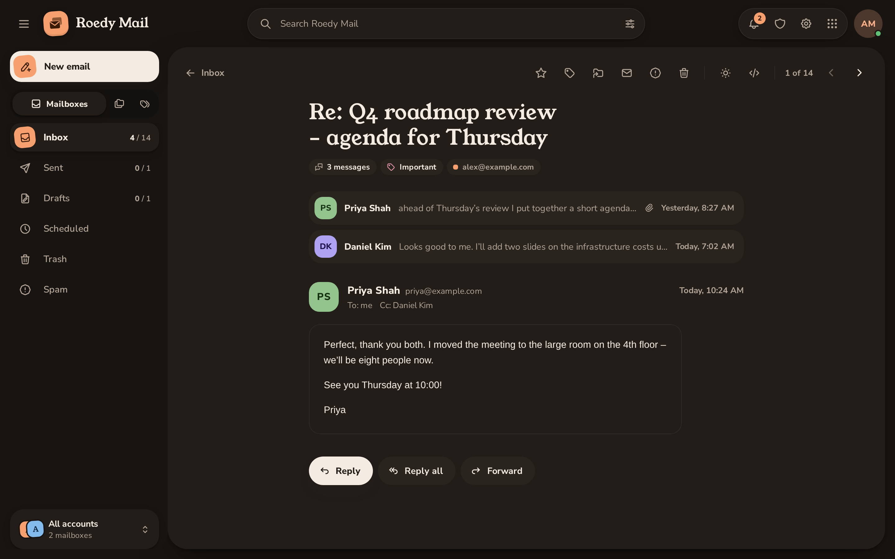
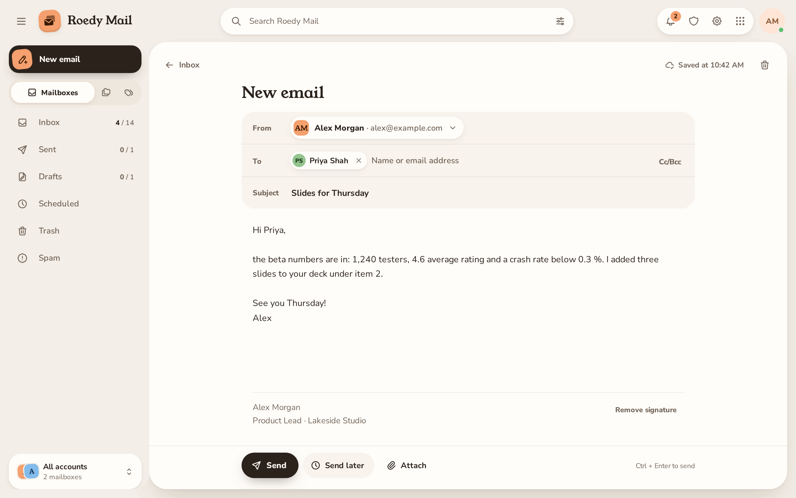
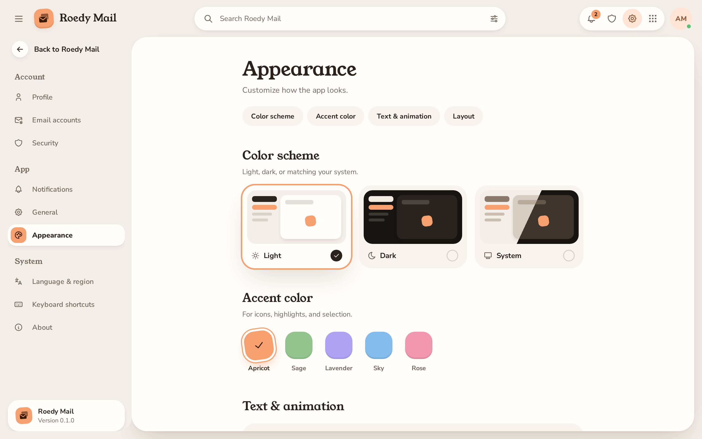
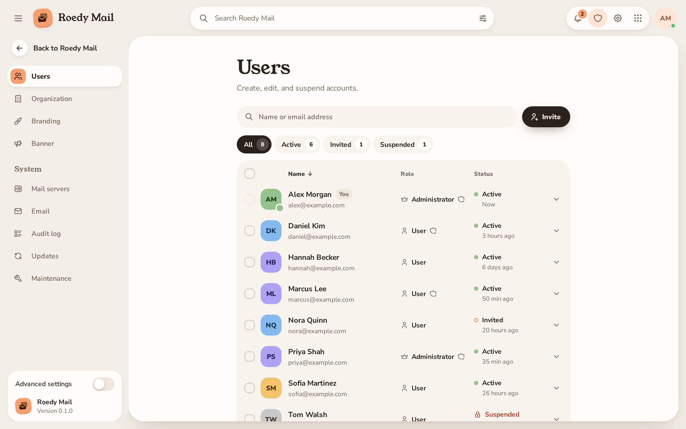
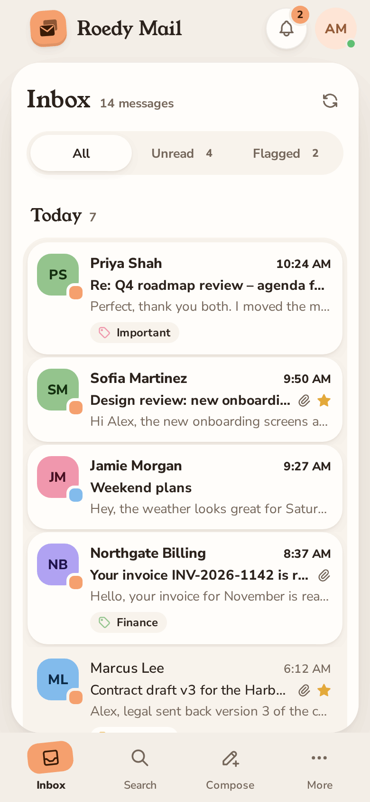
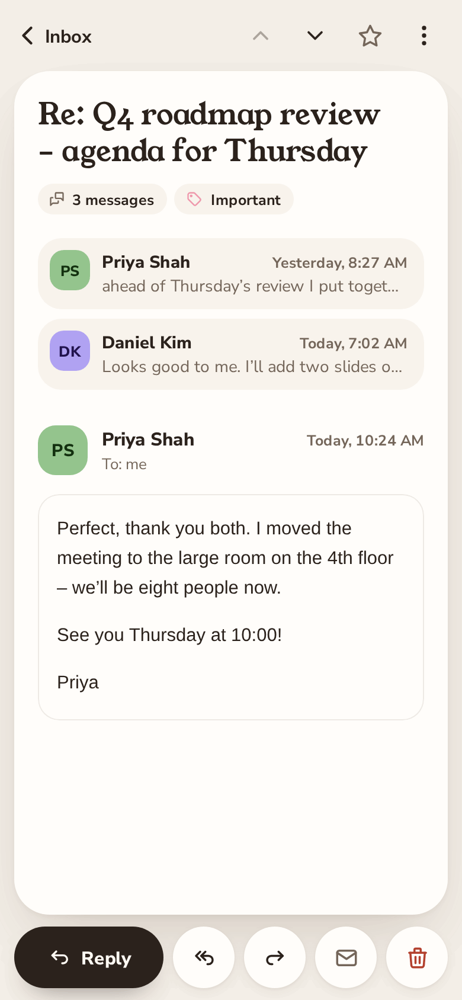

<div align="center">


# Roedy Mail

**A fast, lightweight, self-hosted webmail for [Stalwart](https://stalw.art) – built on JMAP.**

[](https://github.com/roedylabs/mail/actions/workflows/ci.yml)
[](https://github.com/roedylabs/mail/actions/workflows/e2e.yml)
[](https://github.com/roedylabs/mail/actions/workflows/codeql.yml)
[](https://scorecard.dev/viewer/?uri=github.com/roedylabs/mail)
[](https://github.com/roedylabs/mail/releases)
[](LICENSE)

[Quick start](#quick-start) · [Walkthrough](docs/walkthrough.md) · [Documentation](docs/ops.md) · [Contributing](CONTRIBUTING.md)



</div>

## Why Roedy Mail?

- **JMAP all the way.** The browser talks JMAP ([RFC 8620](https://www.rfc-editor.org/rfc/rfc8620)/[8621](https://www.rfc-editor.org/rfc/rfc8621)) directly to your Stalwart servers – with real-time push, batching and incremental sync. No IMAP translation layer.
- **Tiny footprint.** One static binary with the embedded web app and SQLite. The container image is about 14 MB, idles at about 14 MB of memory and starts in a fraction of a second.
- **Feels like an app.** Installable as a PWA, works offline, queues actions and drafts without a connection, and delivers new mail as notifications.
- **Built for teams and families.** Multiple mail accounts per user with a unified "All accounts" view, invitations, two-factor sign-in, and a full administration area.
- **Accessible and bilingual.** Keyboard shortcuts, screen-reader support checked with axe, light and dark themes, English and German.

## Features

| | |
|---|---|
| **Email** | Multiple mail accounts with "All accounts", folders and cross-account tags, compact and comfortable list styles, safe HTML rendering with blocked remote content, attachments, message source, swipe gestures |
| **Compose** | Identities and signatures, attachments, recipient suggestions, reply and forward, undo send and send later, drafts that survive going offline |
| **Search** | Search with filters and suggestions |
| **Organize** | Filter rules and forwarding (Sieve), vacation replies, move and bulk actions |
| **Real time & offline** | Push from the mail server, start without network, mail stored on the device, offline action queue |
| **Account & security** | Setup wizard, invitations, password reset, authenticator apps and recovery codes, signed-in devices, notifications in the app, by email and via web push |
| **Administration** | Users, mail servers with diagnostics and automatic OAuth client registration, system emails with templates, branding, organization details, banners, audit log, update checks, maintenance mode, backups |

<table>
  <tr>
    <td width="50%"></td>
    <td width="50%"></td>
  </tr>
  <tr>
    <td width="50%"></td>
    <td width="50%"></td>
  </tr>
</table>

<p align="center">
  
  &nbsp;&nbsp;
  
</p>

Take the [guided walkthrough](docs/walkthrough.md) for a tour from the first setup to everyday use.

## How it works

```text
Browser (Svelte 5 SPA)
  ├─ JMAP over HTTPS (Bearer token) ──────► Stalwart server(s)
  └─ /api/v1 (session cookie, JSON) ──────► roedy-mail (Rust, axum – one binary, web app embedded)
                                               ├─ SQLite (WAL) in /data
                                               ├─ mail server registry → Content Security Policy
                                               ├─ token broker (refresh tokens encrypted at rest)
                                               └─ system emails, notifications, background jobs
```

Roedy Mail does not proxy your mail. The backend manages app accounts, settings and the list of mail servers, and acts as a **token broker**: it keeps the OAuth refresh tokens of the connected mail accounts encrypted and hands the browser short-lived access tokens. The browser then reads and sends mail directly via JMAP.

## Quick start

**Requirements:** a [Stalwart](https://stalw.art) v1.x mail server (tested with v1.1) and Docker. Prepare Stalwart once as described in [docs/setup/stalwart.md](docs/setup/stalwart.md) (CORS and an OAuth client).

```sh
curl -fsSLO https://raw.githubusercontent.com/roedylabs/mail/main/deploy/compose.yml
curl -fsSL -o .env https://raw.githubusercontent.com/roedylabs/mail/main/deploy/.env.example
chmod 600 .env
${EDITOR:-vi} .env                                # ROEDY_PUBLIC_URL (required), image version
docker compose up -d                              # listens on 127.0.0.1:8080
docker compose logs roedy-mail | grep Setup-Token
```

Without `ROEDY_PUBLIC_URL` (the public address, such as `https://mail.example.com`) the server does not start. Put a reverse proxy with TLS in front of it (for example Caddy, Traefik or nginx), open the URL and follow the setup wizard with the setup token from the log; afterwards add the mail server under Administration › Mail servers. The image `ghcr.io/roedylabs/mail` is available for `linux/amd64` and `linux/arm64`, runs as an unprivileged user on `scratch`, and is signed with [cosign](https://docs.sigstore.dev/). Static binaries are attached to every [release](https://github.com/roedylabs/mail/releases).

## Documentation

| Guide | Content |
|---|---|
| [Operations](docs/ops.md) | Installation, reverse proxy, configuration (`ROEDY_*`), data directory, backups, updates, monitoring, troubleshooting |
| [Preparing Stalwart](docs/setup/stalwart.md) | CORS, OAuth client, allowed servers, sender account, token lifetimes, push, Sieve |
| [Administration](docs/setup/administration.md) | System emails, branding, organization, banner, audit log, updates, maintenance |
| [Notifications](docs/setup/notifications.md) | Notifications in the app, by email and via web push |
| [Installed app](docs/setup/app.md) | PWA, offline use, language |
| [Walkthrough](docs/walkthrough.md) | A guided tour with screenshots |

## Development

```sh
pnpm install          # dependencies and Git hooks
ROEDY_PUBLIC_URL=http://localhost:5173 cargo run -- serve    # backend on http://localhost:8080
pnpm dev              # web app on http://localhost:5173
```

Requires Node 26, pnpm 12 and Rust stable ([mise](https://mise.jdx.dev) installs them with `mise install`). See [CONTRIBUTING.md](CONTRIBUTING.md) for the project layout, checks, conventions and the release process.

| Part | Stack |
|---|---|
| Backend | Rust, axum, tokio, SQLite (rusqlite), askama, rustls |
| Web app | Svelte 5 (runes), SvelteKit as a SPA, TypeScript, Vite, Paraglide i18n |
| Tests | cargo test, Vitest, Playwright end-to-end against a real Stalwart, axe accessibility audit |
| Delivery | Static musl binary on `scratch`, multi-arch image, SBOM, provenance, cosign |

## Community

- Questions and ideas: [Discussions](https://github.com/roedylabs/mail/discussions)
- Bugs and feature requests: [Issues](https://github.com/roedylabs/mail/issues)
- Security: please report vulnerabilities privately, see [SECURITY.md](SECURITY.md)
- Everyone participating is expected to follow the [Code of Conduct](CODE_OF_CONDUCT.md)

## License

Roedy Mail is free software under the [GNU Affero General Public License v3.0 only](LICENSE) (`AGPL-3.0-only`). If you modify Roedy Mail and offer it to users over a network, you must make the source code of your version available to them; the app links its source code on the About page (configurable under Administration › Organization).

Roedy Mail is an independent project and not affiliated with Stalwart Labs.
