# Walkthrough

A guided tour of Roedy Mail: from the first start of the container through everyday use to the administration area. All screenshots show fictitious demo data; maintainers regenerate them with `just screenshots` (see [`scripts/screenshots/capture.mjs`](../scripts/screenshots/capture.mjs)).

**Contents:** [Getting started](#getting-started) · [Everyday use](#everyday-use) · [Administration](#administration)

## Getting started

### 1. Prepare Stalwart and start the container

Roedy Mail needs a Stalwart v1.x server that is reachable over HTTPS, allows requests from the browser (CORS) and accepts an OAuth client for the app. [Preparing Stalwart](setup/stalwart.md) lists the few settings once; the installation with Docker Compose and a reverse proxy is described in [Operations](ops.md#installation).

After the first start, the server writes a one-time **setup token** to its log:

```sh
docker compose logs roedy-mail | grep Setup-Token
```

### 2. Enter the setup token

Open the app's address in the browser. As long as there is no administrator, Roedy Mail opens the setup wizard, which asks for the setup token first. The token proves that you operate the server and is only valid until the setup is complete.

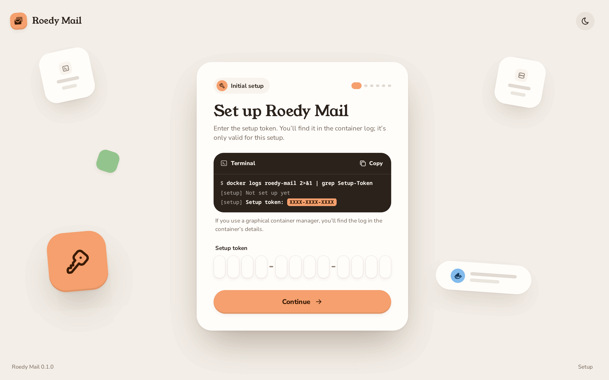

### 3. Create the administrator

The next two steps create your own account: name and email address, then a password. The password has to meet the rules shown below the field before you can continue.

### 4. Connect the mail server

Enter the address of your Stalwart server, a name and the email domains it serves. Under **OAuth client**, choose **Automatic** and sign in once with an administrator's app password: Roedy Mail registers its OAuth client with Stalwart and does not keep these credentials. **Test connection** then checks the JMAP session, the CORS headers and the OAuth client. The public URL is the address under which people open Roedy Mail. Details and the manual alternative: [Preparing Stalwart › OAuth client](setup/stalwart.md#oauth-client).

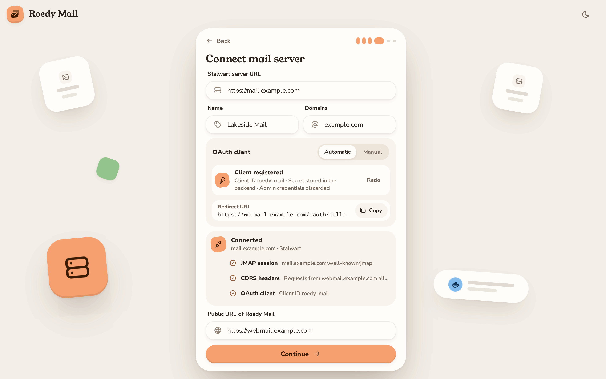

### 5. System emails and summary

System emails are optional: with a sender account (ideally with an app password), Roedy Mail sends invitations, password reset links and notices by email ([Sender account](setup/stalwart.md#sender-account-for-system-emails)). The last step shows everything at a glance; **Finish setup** signs you in as the administrator.

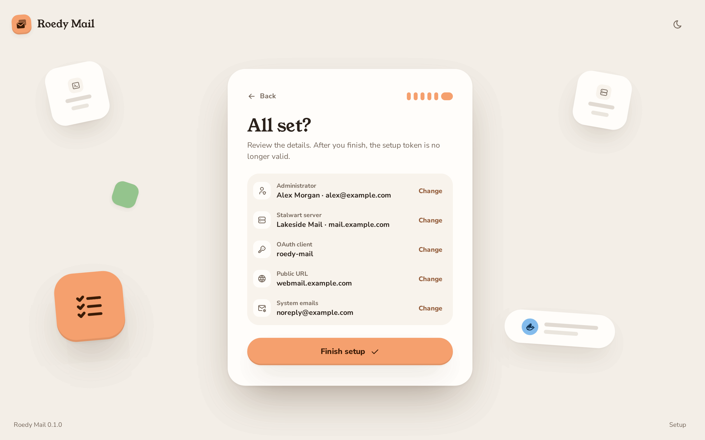

Afterwards, back up the instance key and check the backup schedule, as listed in [Operations › Initial setup](ops.md#initial-setup).

### 6. Add your mail accounts

Roedy Mail itself stores no emails – you connect one or more mail accounts to your app account. Under **Settings › Email accounts**, choose **Add email account** and enter the address: the server is picked automatically from its domain. **Continue to sign-in** opens the sign-in page of your mail server; after signing in (with a second factor, if you use one), you return to Roedy Mail.

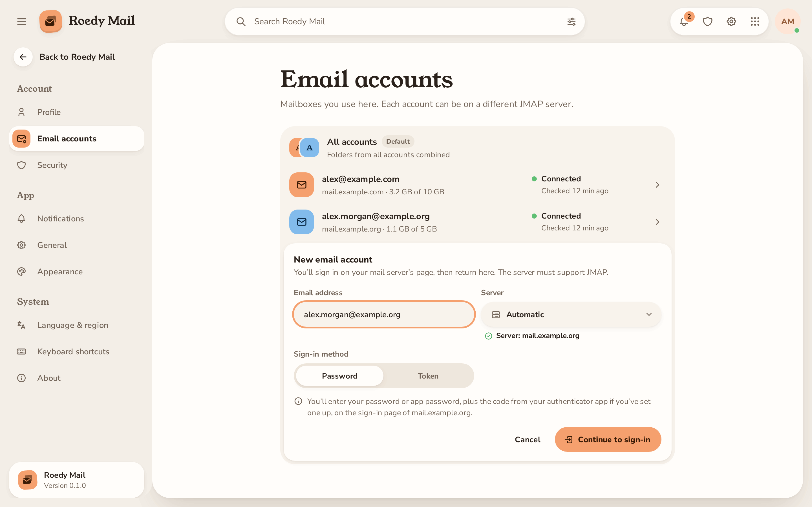

Every account can live on a different JMAP server. With more than one account, **All accounts** combines their folders in one view and can be set as the default.

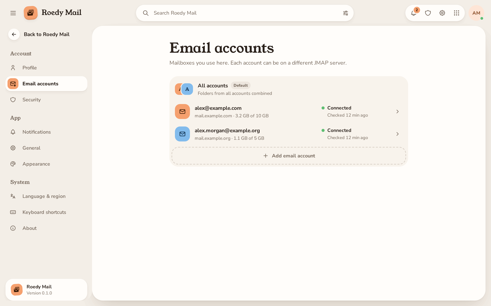

### 7. Sign in

Everyone else signs in on the sign-in page with their email address or username and password. Its title, text and artwork come from the branding settings. Forgotten passwords can be reset by email once system emails are set up.

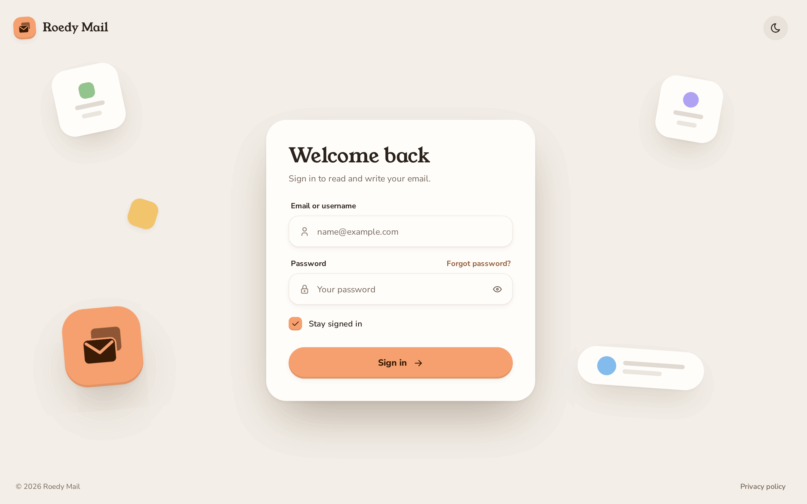

## Everyday use

### The mailbox

The sidebar holds **New email**, the mailboxes, your own folders and tags (switch between them with the tabs above the list), and the account switcher at the bottom. The list groups conversations by day and shows unread messages, stars, attachments, tags and – in "All accounts" – a dot in the account's color. **All**, **Unread** and **Flagged** filter the list; on phones and tablets a swipe across a row moves or deletes it (configurable under **Settings › General**).

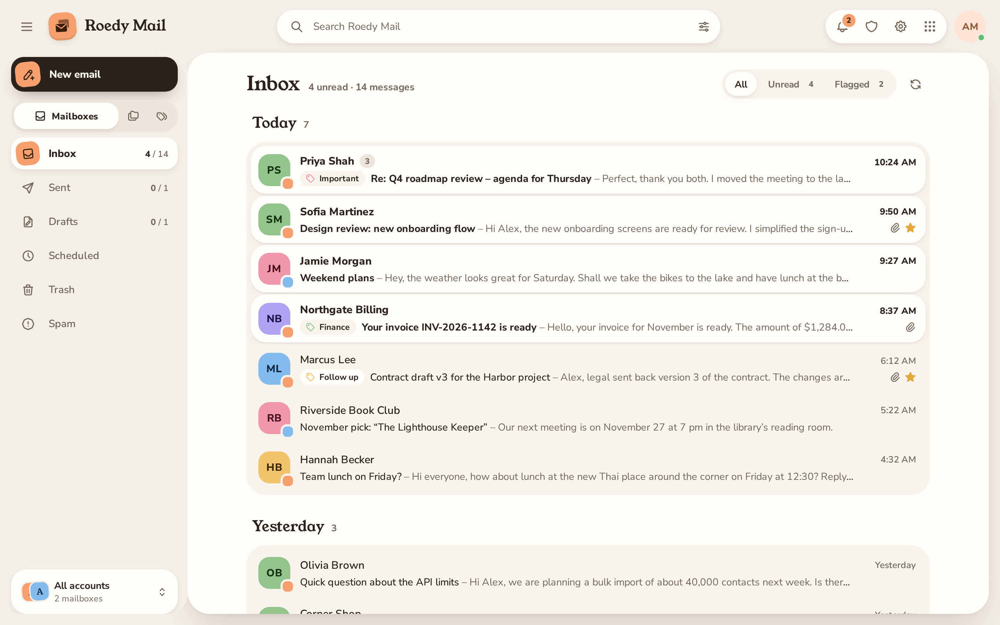

### Reading an email

Opening a conversation shows its messages one below the other, the newest expanded. HTML emails are rendered safely in a sandbox, and remote images stay blocked until you allow them. The toolbar stars, tags, moves, marks as unread, reports spam or deletes; attachments open or download with a click. `J`/`K` or the arrow keys move to the next or previous conversation, `R` replies and `F` forwards.

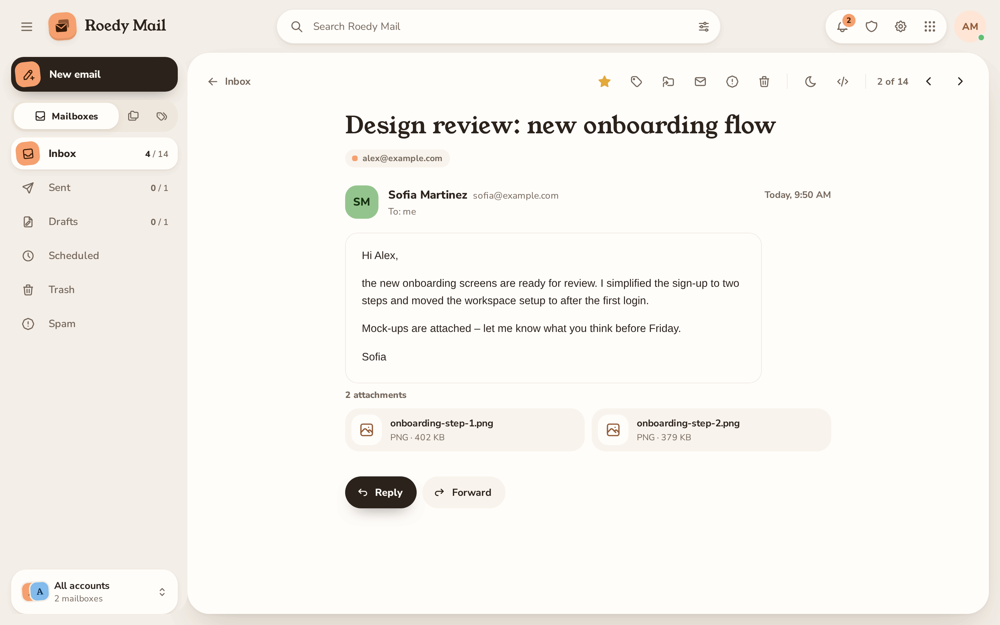

Every page also comes in a dark theme – it follows your system or your choice under **Settings › Appearance**.

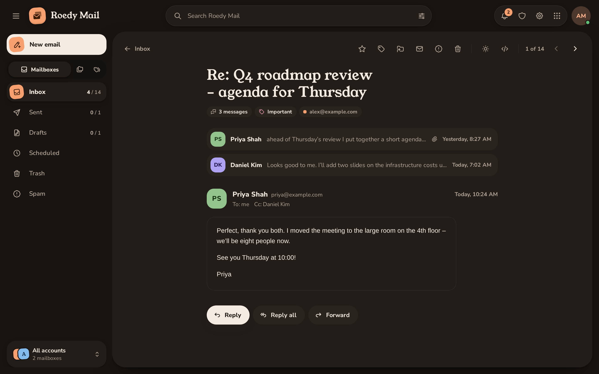

### Writing an email

**New email** opens the editor with recipient suggestions from your organization's directory and your contacts. Choose the sender identity, add Cc and Bcc, attach files and keep or remove the signature. Drafts save themselves while you type, also without a connection. **Send** gives you a few seconds to undo; **Send later** schedules the email on the mail server.

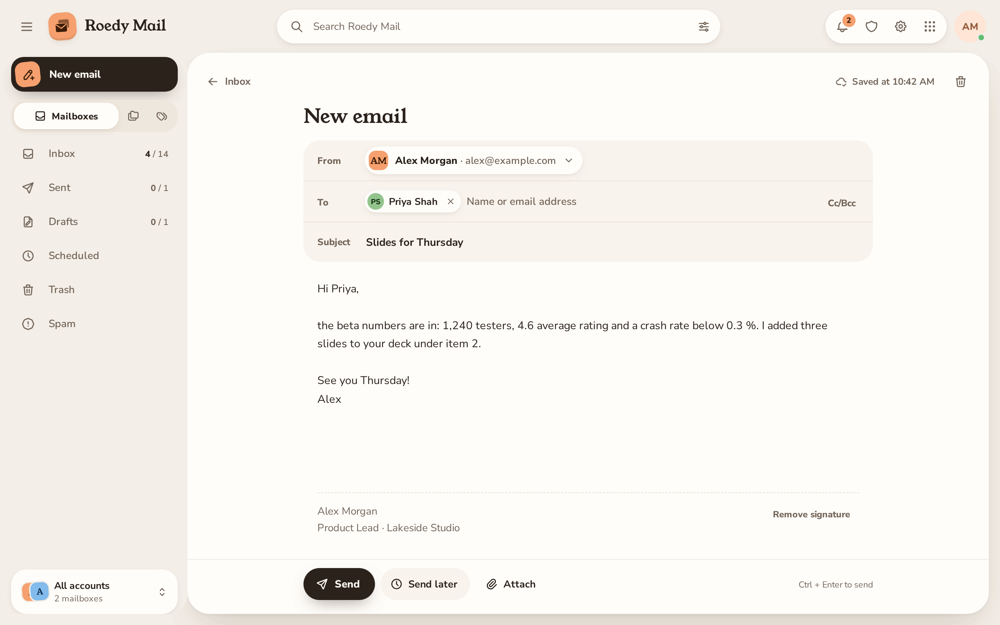

### Search

Type in the search field at the top: suggestions appear while you type, `Enter` shows all results. The results separate messages from attachments, and the filter panel narrows them down by status, date, account, folder and tag. `Ctrl`+`K` (`⌘`+`K` on a Mac) opens the command palette for actions and pages.

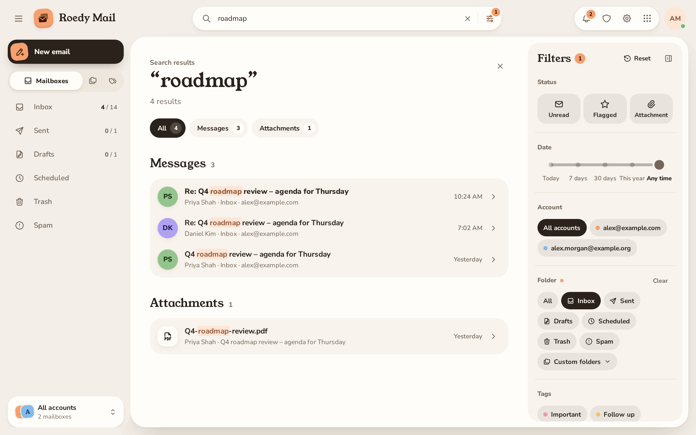

### Organizing

Select several conversations to move, tag, archive or delete them in one go; **Undo** in the toast reverts the last action. Tags work across all your accounts: the same tag appears in every mail account and shows a combined count in the sidebar. **New folder** and **New tag** are in the sidebar and the command palette.

### Rules and forwarding

Each mail account has its own **Rules** page under **Settings › Email accounts**. Filter rules move, tag, mark as read, forward or delete new messages that match conditions on sender, recipient, subject, size or attachments. Rules are stored as a Sieve script on the mail server, so they apply even when Roedy Mail is closed and in other apps as well.

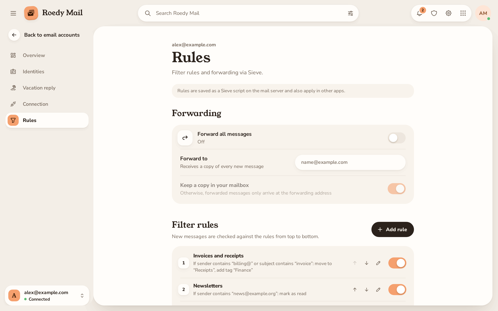

### Vacation reply

The **Vacation reply** page of a mail account sends an automatic reply for a date range. Each sender receives it only once per absence; while it is on, forwarding and filter rules are paused.

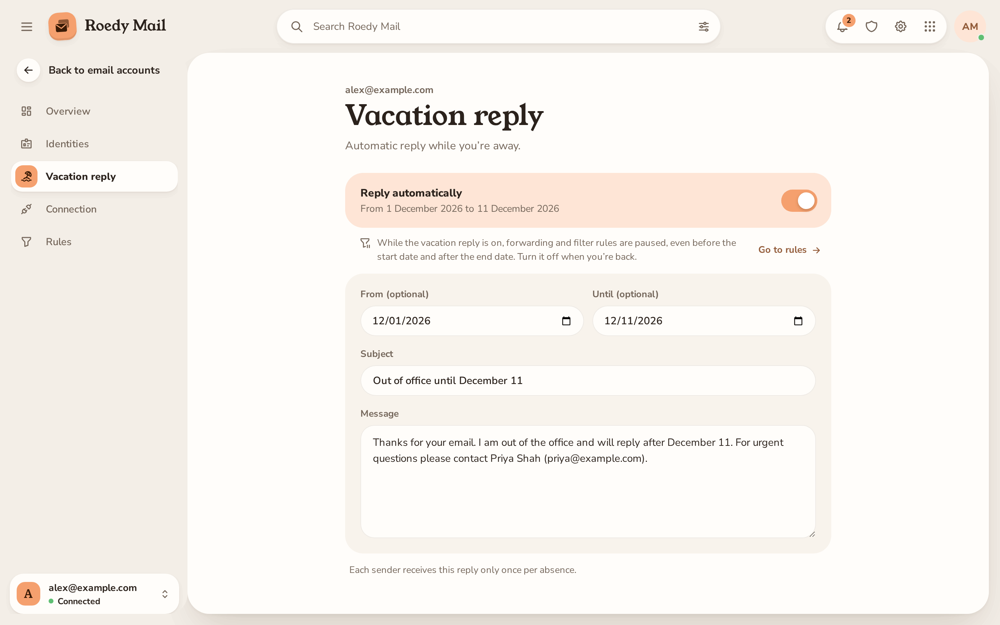

### Notifications

The bell at the top right lists security events, team changes, system notices such as backups, and changes to your account. Under **Settings › Notifications** you choose for each topic whether it appears in the app, by email or as a push notification on your devices, set quiet hours and decide which new emails should notify you. Details: [Notifications](setup/notifications.md).

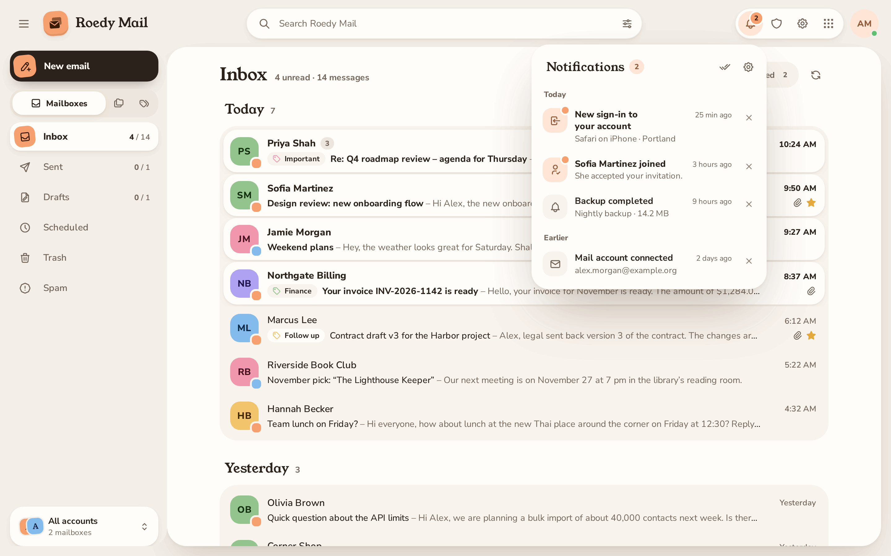

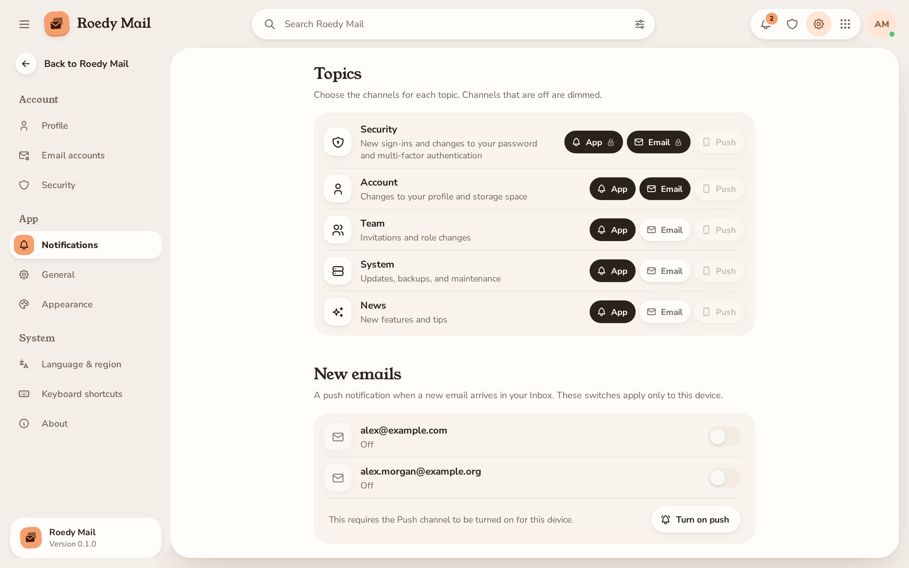

### Settings

Your settings follow you to every device: color scheme, accent color, text size, density and list style under **Appearance**; start page, confirmations and swipe actions under **General**; language, region, time zone and formats under **Language & region**; and all keyboard shortcuts under **Keyboard shortcuts**. **Security** manages your password, authenticator apps, recovery codes and signed-in devices.

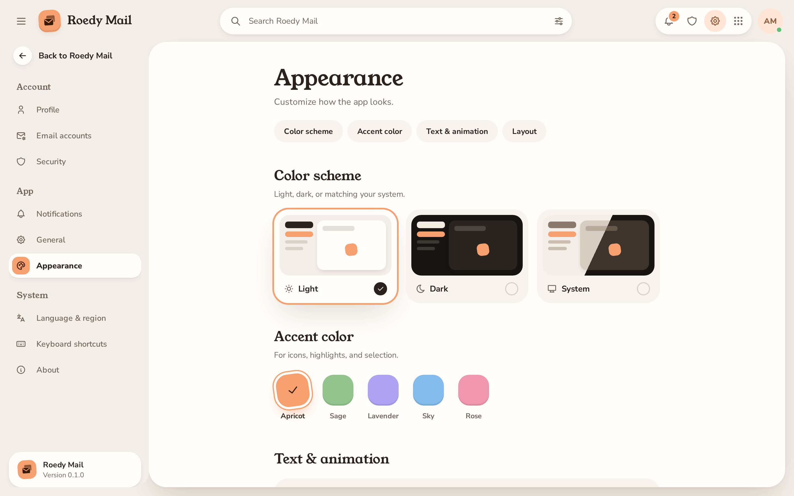

### On your phone, installed and offline

The same app adapts to small screens with a tab bar and full-screen conversations. Install it from the browser (for example "Install app" or "Add to Home Screen") to get its own window, `mailto:` handling and push notifications. Mailboxes and recently opened conversations stay on the device: Roedy Mail starts without a network, searches stored emails and queues actions and drafts until the connection returns. Details: [Installed app](setup/app.md).

<p>
  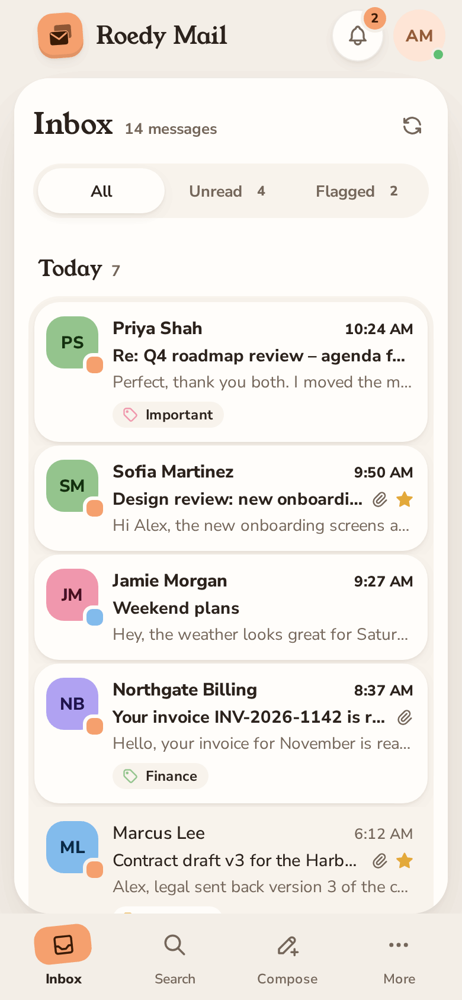
  &nbsp;&nbsp;
  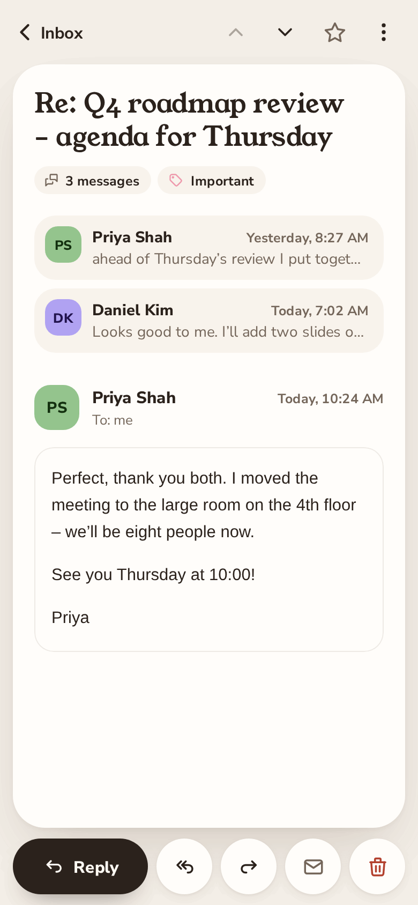
</p>

## Administration

Administrators reach the administration area with the shield icon in the header. An overview of all pages is in [Administration](setup/administration.md).

### Users and invitations

**Users** lists everyone with role, two-factor status and last activity. **Invite** sends an invitation by email; without system emails, **Copy link** gives you a link to pass on. **Change role** and **Suspend** are in each user's row, and the filters show active, invited and suspended users.

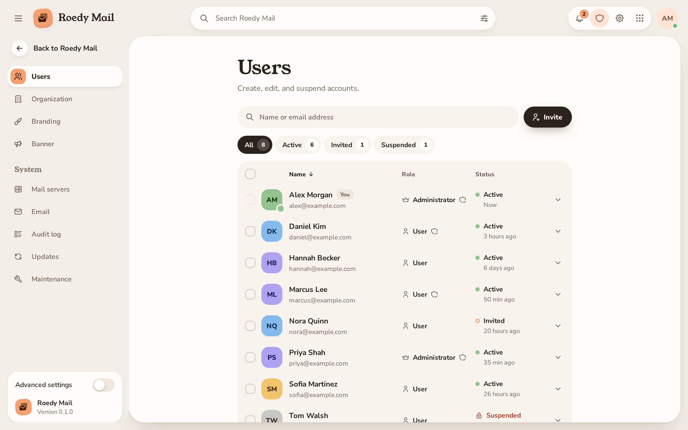

### Mail servers

Only servers on this list can be used for mail accounts; the list also feeds the app's Content Security Policy. Each entry shows its domains and the result of the last **Test connection**, with **Show diagnostics** for details. **Add server** registers the OAuth client automatically, as in the setup. Troubleshooting the diagnostics: [Preparing Stalwart › Diagnostic reasons](setup/stalwart.md#diagnostic-reasons).

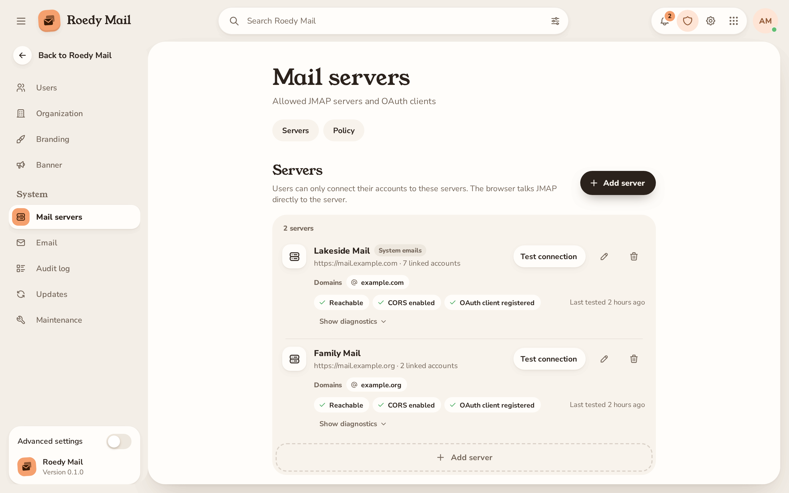

### Branding, organization and banner

**Branding** sets the app name, the logo (initials, an icon or your own image), the brand color and the sign-in page; the installed app's icons follow it. **Organization** adds contact details and legal links, **Banner** shows a notice to everyone, and **Email** sets the sender account and the templates of system emails. Details: [Administration › Branding](setup/administration.md#branding).

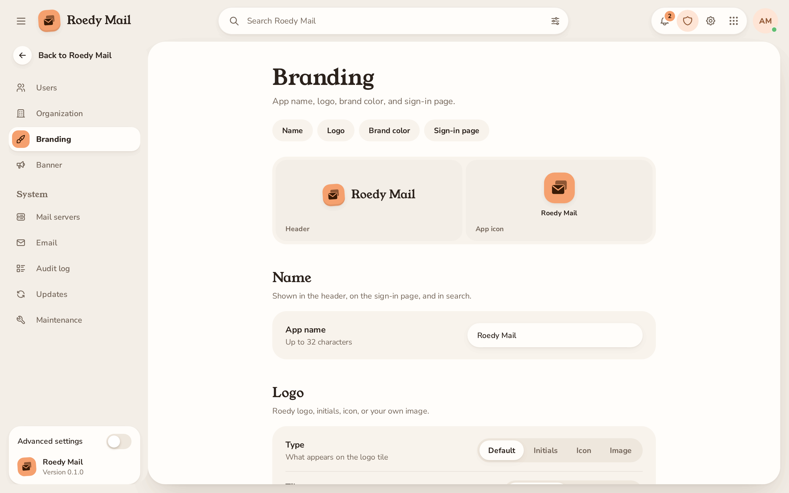

### Backups and maintenance

**Maintenance** creates backups of Roedy Mail's own database – daily and kept for 30 days by default – and offers download, restore and **Back up now**. Maintenance mode locks the app for everyone except administrators while you work on the server. Emails are not part of the backup; they stay on the mail server. Details: [Operations › Backup and restore](ops.md#backup-and-restore).

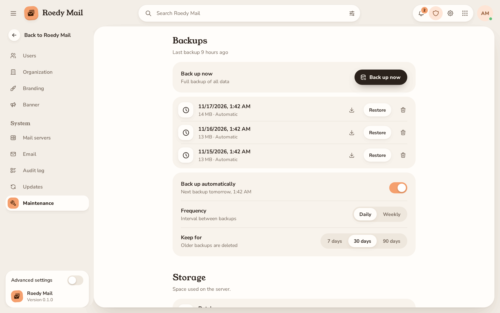

### Updates and audit log

**Updates** shows the installed version and checks the public releases on a schedule. Roedy Mail installs nothing by itself: you pull the new image and restart the container, as described in [Operations › Updates](ops.md#updates). The **Audit log** records sign-ins and changes for traceability.

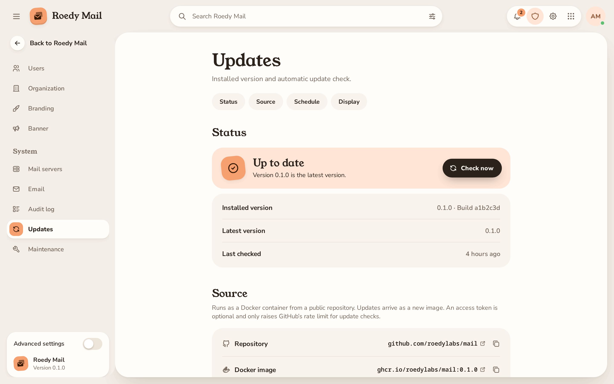
